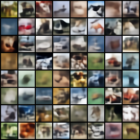
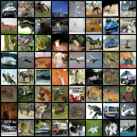
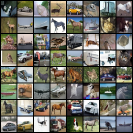
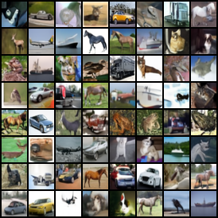
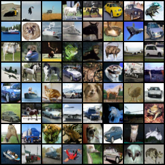

# image-gen-models

From-scratch PyTorch implementations of four generative model families, trained and compared
on CIFAR-10 (32x32, unconditional): VAE, flow matching (rectified flow), GAN, and DDPM.

## Results (CIFAR-10)

FID uses 10k samples vs. the training set (torch-fidelity, `inception-v3-compat`). Lower is
better. On this protocol, real test images score 3.15. The full table, the GAN ablation,
sample grids, and the config/checkpoint behind every number are in
[`results/cifar10.md`](results/cifar10.md).

| Model | Params | Train time (3090 Ti) | NFE | s / 1k imgs | FID |
|---|---|---|---|---|---|
| VAE | 12.5M | 23 min (50k steps) | 1 | 0.06 | 125.5 |
| GAN (NS + SN + R1) | 24.9M (G+D) | 2h21m (100k steps) | 1 | 0.05 | 21.1 |
| Flow matching, Euler 10 / 20 / 50 | 35.8M | 6h16m (100k steps) | 10 / 20 / 50 | 5 / 11 / 26 | 18.7 / 13.6 / 10.9 |
| DDPM, DDIM 10 / 20 / 50 | 35.8M | 6h29m (100k steps) | 10 / 20 / 50 | 5 / 11 / 26 | 20.8 / 16.1 / 13.5 |
| DDPM, ancestral | 35.8M | (same model) | 1000 | 526 | **7.7** |

| VAE | GAN | Flow matching (Euler 50) | DDPM (DDIM 50) | DDPM (ancestral) |
|---|---|---|---|---|
|  |  |  |  |  |

## Comparison

**VAE.** Fastest to train and to sample, and by far the worst FID. Samples are blurry, with
the right colors and rough layouts but no object detail. This follows from the loss: with a
Gaussian (MSE) decoder, the best output for an uncertain pixel is the average of the
possibilities, and the average is blurry. The KL term also limits how much detail the latent
can carry.

**GAN.** One network evaluation per sample, ~500x faster to sample than 50-step FM and
~10,000x faster than ancestral DDPM, at an FID between 10-step and 20-step diffusion. Its
images are sharp, but getting it to train was the hard part. The plain DCGAN recipe failed
completely (FID 560: D wins in about 100 steps and G stops getting gradient). Each stabilizer
added to it gave a large improvement: non-saturating loss 52.8, spectral norm 37.2, R1 31.5
(at 30k steps). Even the final run showed D slowly gaining on G, so a longer run might
degrade.

**Flow matching vs. DDPM.** These two share the U-Net, optimizer, batch size, and 100k
steps, so the only differences are the training target and the sampler.
- With deterministic few-step samplers (Euler for FM, DDIM for DDPM), FM wins at every
  budget, by 2.1-2.6 FID. The straight-line path `x_t = (1 - t) x0 + t x1` gives a
  trajectory that is easier to follow with large Euler steps than the curved DDPM path.
- DDPM with 1000 ancestral steps gives the best FID overall (7.7), at 20x the cost of
  50-step sampling. Ancestral sampling injects fresh noise at every step, which corrects
  errors made earlier in the trajectory; deterministic samplers have to carry those errors
  through to the end.
- From the same starting noise, FM Euler-50 and DDPM DDIM-50 produce nearly the same image in
  most tiles (compare the two grids). Both are ODE samplers that map noise to data through
  Gaussian paths with the same endpoints, so the two models learned close to the same mapping.
  Ancestral sampling, being stochastic, produces different images.
- Training cost is the same: about 6.3 h and 7.45 GB peak memory for each.

**Overall.** Sample quality ranks diffusion/flow > GAN >> VAE, and sampling cost ranks in
the reverse order. For the later text-to-image project, flow matching is the best default:
same training cost as DDPM, better few-step samples, and simpler code (no noise schedule).

Caveats: one seed per model; VAE trained 50k steps vs. 100k for the others (it had
plateaued); 10k-sample FID runs higher than the usual 50k-sample number, so compare these
values only with each other, not with published results.

## Reproducing

```bash
uv sync
uv run python -m src.train_fm --config configs/fm_cifar10.yaml      # likewise vae / gan / ddpm
uv run python -m src.eval_fid --ckpt runs/fm_cifar10/last.pt --n 10000 --steps 50
uv run python -m src.sample   --ckpt runs/fm_cifar10/last.pt --steps 50
```

## Reference

* [Lilian Weng - "What are diffusion models?"](https://lilianweng.github.io/posts/2021-07-11-diffusion-models/)
* [Calvin Luo - "Understanding Diffusion Models: A Unified Perspective"](https://arxiv.org/abs/2208.11970)
* [Meta - "Flow Matching Guide and Code"](https://arxiv.org/abs/2412.06264)
