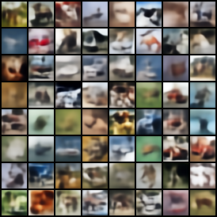
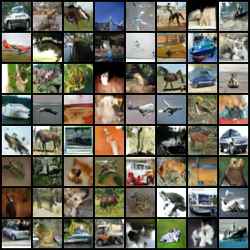
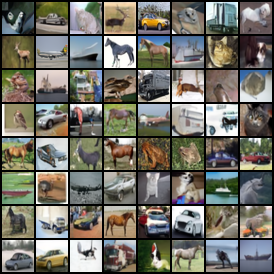
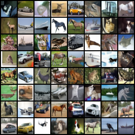
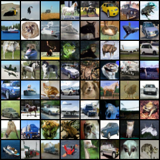

# CIFAR-10 (32x32, unconditional)

All runs: seed 0, batch 128, fp32, one RTX 3090 Ti. FID uses torch-fidelity 0.4.0
(`inception-v3-compat`), 10k generated samples vs. the full 50k training split. Sampling
uses EMA weights where the model has them (FM, DDPM). Sampling cost is measured at batch
500.

| Model | Sampler | Params | Train steps | Train time | Train peak GPU | NFE | s / 1k imgs | FID (10k) |
|---|---|---|---|---|---|---|---|---|
| VAE | decoder | 12.53M | 50k | 0h23m | 1.15 GB | 1 | 0.06 | 125.51 |
| GAN (NS + SN + R1) | generator | 13.13M G + 11.72M D | 100k (G) | 2h21m | 1.64 GB | 1 | 0.05 | 21.06 |
| Flow matching | Euler 10 | 35.75M | 100k | 6h16m | 7.45 GB | 10 | 5.3 | 18.66 |
| Flow matching | Euler 20 | | | | | 20 | 10.5 | 13.64 |
| Flow matching | Euler 50 | | | | | 50 | 26.3 | 10.94 |
| DDPM | DDIM 10 | 35.75M | 100k | 6h29m | 7.45 GB | 10 | 5.4 | 20.76 |
| DDPM | DDIM 20 | | | | | 20 | 10.5 | 16.14 |
| DDPM | DDIM 50 | | | | | 50 | 26.3 | 13.54 |
| DDPM | ancestral 1000 | | | | | 1000 | 525.7 | **7.67** |

Peak GPU memory while sampling (batch 500): VAE 1.35 GB, GAN 0.86 GB, FM / DDPM 3.85 GB.

For reference, two real-image sets scored against the same training split: 10k training
images 2.10, the 10k test split 3.15. These are the practical floor for this protocol.

## GAN stabilizer ablation (30k G steps each)

| Stage | Change | FID (10k) |
|---|---|---|
| 1 | DCGAN baseline (saturating loss, BatchNorm D) | 559.79 |
| 2 | + non-saturating G loss | 52.81 |
| 3 | + spectral norm in D (replacing BatchNorm) | 37.18 |
| 4 | + R1 penalty, gamma 0.1 | 31.49 |

## Fixed-seed 8x8 grids (sample seed 1234)

| VAE | GAN | Flow matching, Euler 50 |
|---|---|---|
|  |  |  |

| DDPM, DDIM 50 | DDPM, ancestral 1000 |
|---|---|
|  |  |

## Provenance

| Row | Config | Checkpoint | FID result |
|---|---|---|---|
| VAE | `configs/vae_cifar10.yaml` | `runs/vae_cifar10/last.pt` | `runs/vae_cifar10/fid_n10000.json` |
| GAN | `configs/gan_cifar10.yaml` | `runs/gan_cifar10/last.pt` | `runs/gan_cifar10/fid_n10000.json` |
| GAN ablation | `configs/gan_cifar10.yaml` + overrides in commit 5336e78 | `runs/gan_cifar10_abl{1..4}_*/last.pt` | `runs/gan_cifar10_abl*/fid_n10000.json` |
| Flow matching | `configs/fm_cifar10.yaml` | `runs/fm_cifar10/last.pt` | `runs/fm_cifar10/fid_n10000_steps{10,20,50}.json` |
| DDPM | `configs/ddpm_cifar10.yaml` | `runs/ddpm_cifar10/last.pt` | `runs/ddpm_cifar10/fid_n10000_{ancestral,ddim_steps{10,20,50}}.json` |

Train time and train peak GPU come from the end of `runs/<run>.log` (`done: ...` line).
The grids come from `uv run python -m src.sample --ckpt <ckpt> [--sampler ...] [--steps ...]`.
